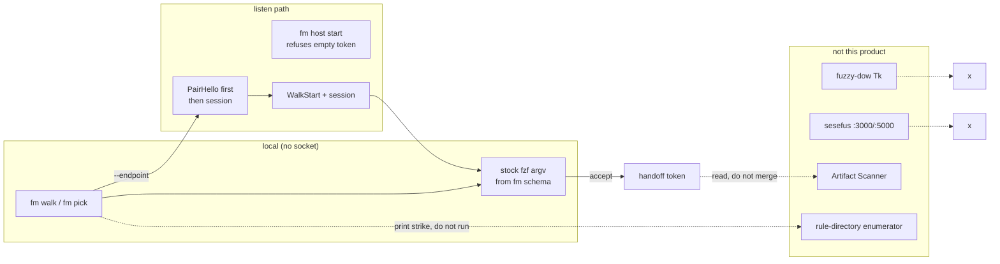
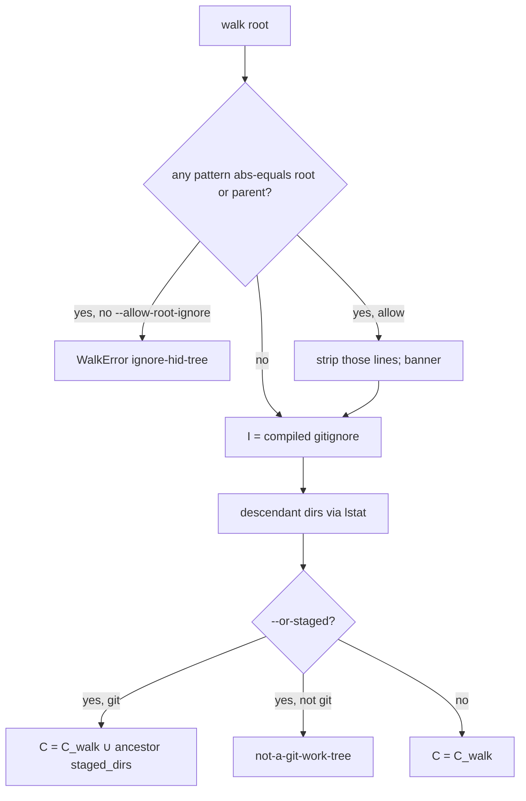

# Fuzzy Mirror v1.0p — Host:Client Fuzzy-Find Contract

| Field | Value |
|---|---|
| **Title** | Fuzzy Mirror: isolate fuzzy-find; CLI derives the UI |
| **Author** | Grok (design sitting; `/design` writer) |
| **Date** | 2026-09-18 |
| **Status** | Approved / landed 2026-09-18 as `fuzzy-mirror/DESIGN.md`. Frozen v1.0p (docs). Runtime absent. OQ2/OQ15 closed by operator. |
| **Release** | v1.0p = prototype **contract**, not a shipped binary |
| **Product home** | `C:\dev\sesephus\fuzzy-mirror\` |
| **This sitting** | Docs-only. No runtime. No vendor into `C:\dev\sesefus`. |
| **Public lineage** | `theRensisioure/sesephus` (`C:\dev\sesephus`) |
| **Neighbor, not this product** | `C:\dev\sesephus\fuzzy-dow\` |
| **Packet** | `…\01a0b5bb-b7bc-7773-887d-80025e5feade\intent\interview.md` |
| **Normative** | **§ Contract (C0–C9)** wins over hats. Hats are rationale. |

This file is the **engineering form** of the v1.0p contract. README / CHANGELOG / `CONTRACT.md` land under `fuzzy-mirror/` after review consensus (goal G4). An implementer should be able to build from **§ Contract** plus **§ Key Decisions**.

---

## Overview

Fuzzy-find is currently smeared across a Tk session-file keeper (`fuzzy-dow`), a Linux-only FZD house on **dev@SPN** (`fzd-list` / `~/.fzdignore`), a draft *rule-directory* enumerator (`potential-fuzzy-directory.md`), and an alarm/audio host:client pair that binds unauthenticated TCP/HTTP (`core/sesephus`). None of those is an isolated finder whose UI is derived from a CLI contract.

**Fuzzy Mirror** isolates fuzzy-find. The operator runs a CLI (`fm`). Local pick walks in-process and never opens a port. Remote pick talks to a host that **refuses to listen without a pairing token**, requires `PairHello` as the first message, and requires a `PairOk` session before any walk. The host walks a tree once and ships a snapshot. The client filters locally. The v1.0p **UI generator** is `fm schema` JSON → stock `fzf` argv (`--read0`, `--bind` from `.keymap`, `--header` / `transform-header` from C6). That is not Syncthing REST→HTML parity. Pairing is Syncthing-shaped (token file + host **approve**). The interface reports **corrections**. It does not praise.

v1.0p freezes that contract. It does not ship a binary. Picker is stock `fzf` (do not source-fork). First code PR **freezes Python** for ignore / walk / host (A9 cheapest cross-platform path). Until that PR, the docs do not pretend a Zig binary was chosen because `sesefus.exe` is Zig.

---

## Background & Motivation

### Why isolate the finder

Systematic debugging needs one honest surface for “where is the directory?” Terminal multiplexers, agent tools, and suite dashboards all steal keys and conflate empty with failed. The user ask: isolate fuzzy-find with proper keybinding, a fuzzy directory, staged-or-profiling ignores, a remote fzf-class host:client, and a CLI that derives its UI.

Artifact Scanner is a **finder of artifacts**, not this product. FZD chooses a **place** (host + absolute directory). Scanner examines what is there. They share a handoff token. They do not merge. (`C:\Users\bardw\artifact-scanner\docs\FUZZY-DIRECTORY-REVIEW.md:37-47`.)

### Current state (cited; absent beats invention)

| Surface | What it actually is | What it is not |
|---|---|---|
| `fuzzy-dow/fzdow.py` | Tk 420×560 card; subsequence fuzzy over **parents of buffered files** (`fzdow.py:238-257`). Keys only on query+root Entry (`:230-231`). Listboxes bind `<<ListboxSelect>>`, not Key (`:201`). Linux+X (`README.md:40-42`). | Not a directory walk. Not host:client. Not a CLI TUI. |
| `fuzzy-dow/buf/src/main.zig` | `fzbuf ingest\|list\|keep`. Local `~/test-buffer`. Atomic `index.tsv`. No net (`main.zig:31-35`). | No keys. No ignore engine. |
| `fuzzy-dow/clump.py` | Folder clumper. Hardcoded `SKIP` (`clump.py:26-30`). Not wired to the window (`README.md:35-36`). | Not FZD. Not a profile file. |
| SPN FZD house | Live on **Linux dev@SPN**, not this Windows tree: `~/.local/bin/fzd-list`, `~/.fzdignore` / `~/.fzfignore`, `# --- ADVANCED` marker, `ctrl-a` toggle, `~/.fzdroots`. Cited from `C:\Users\bardw\claude-consolidation.md:30-31,98-105`. **Not in this repo.** Line `:105` is garbled; the 5906→3497 count is still in that line. | Not Fuzzy Mirror. Verify live before treating as SSOT. |
| `potential-fuzzy-directory.md` | Draft-0: “Directory means a finite, named set of **rule files**… not a filesystem browser.” Transcript → state → rules → strike list → **existing** fzf binder (`…\Downloads\potential-fuzzy-directory.md:21-23,207-213`). `ollama serve` not a kill target (`:43`, `:199`). | Not FZD. Do not collapse the nouns. |
| Sesefus host:client | One `sesefus.exe`, `--role host\|client` (`docs/CANON.md:80-82`). TCP **5000** and HTTP **3000** on `0.0.0.0` (`host.zig:379-385,864-867`). First message `RegisterClient` (`host.zig:409-424`, `client.zig:258-264`). Alarm JSON + `audio_data_base64` (`common.zig:37-53`). Subnet connect-probe (`discovery.zig:33-34`). Vault password literal at `host.zig:165` and `:328` (CANON still points at `:198` — stale). | Not fuzzy-find. Unauthenticated. **Do not reuse.** |
| `src/net/protocol.zig` | Length-prefixed JSON twin of `common.zig`. **Unused** by `core/sesephus/build.zig` (no import). | Not a search protocol. |
| CLI → UI | “All user and dashboard interactions must route through this Zig CLI (or its mirrored HTTP API)” (`docs/CLI.md:13`). Dashboard is a **mirror**, not a generator. `--json` is **parsed but inert** (`docs/CANON.md:84-85`, `docs/CLI.md:24-25`). `docs/cli_surface.jsonl` inventories invoke/flags; it does not emit widgets. | Pattern “CLI argv is the contract; UI is generated from it”: **absent**. |
| Method Cards | Frozen docs-only (`docs/specs/method-card-schema-v1.md:27-35`, `method-card-boundary-v1.md:14-22`). Not host/client, pairing, or transport. | Not this protocol. |
| Three dashboards | React/Vite `:5173`, embedded `dashboard.html` `:3000`, Tauri `aether-dashboard-v2`. COVENANT: user path must complete without them (`docs/COVENANT.md:58-60`). | Not Fuzzy Mirror UI. |

### Pain (user corrections, not inferred taste)

1. **Keys fight the query.** `fzdow.py:284-306` binds only on the query + root `Entry` (`:230-231`). Listboxes have `<<ListboxSelect>>` (`:201`), no Key bind. Click steals focus; arrows then do nothing (`:278-282`). `Ctrl-h` is column-switch (`:290-291`) — fzf/emacs `Ctrl-h` is backspace.
2. **“Directory” was collapsed.** FZD = filesystem dirs only, nested, never file titles (`FUZZY-DIRECTORY-REVIEW.md:11-17,63-67`). potential-fuzzy-directory = rule-file set (`potential-fuzzy-directory.md:21-23`). Hardcoding `ollama run qwen3.8` was a **user correction**.
3. **Silent blanket ignore hid the tree.** A bare `/home/dev` line in both ignore files matched every path (`claude-consolidation.md:100`). That is a defect, not a profile. C3 names the match algorithm so it cannot recur on paper.
4. **Remote walk vs keystroke.** SSH latency belongs on enumeration, not each keypress (`FUZZY-DIRECTORY-REVIEW.md:31-32,52-53`). Saying “no directories” after a failed scan is a lie (`:32,69-70`).
5. **Unauthenticated pair temptation.** Current host binds `0.0.0.0:5000` with `RegisterClient` and no token (`host.zig:379-424`). SSH-forwarded loopback without PairHello is the same fence. Do not copy this pair.
6. **CLI-drives-UI is a claim without a generator.** `--json` inert. PRODUCTION.md still talks as if the sidecar ran `sesephus <command> --json` (`docs/PRODUCTION.md:9`). Fuzzy Mirror must not repeat that lie. v1.0p generator = schema → fzf argv (C7).

### What is not Fuzzy Mirror

- `fuzzy-dow` (session-file keeper; etymology “fuzzy window directory”).
- Artifact Scanner `/` fzf row, suite cards, AyTree.
- Clippers / Voice / Circadia remote / grok-launcher (parked) / Grok `@` picker / `/terminal-setup` (ghost slash).
- `chess-fuzzy-finder` on SPN.
- Private `C:\dev\sesefus`.
- Method Cards as runtime.
- potential-fuzzy-directory **strike enumerator**, unless this contract’s binder-consumer clause is used later. Fuzzy Mirror **prints** a strike record; it does not execute it.

---

## Goals & Non-Goals

### Goals (v1.0p contract)

- **G1.** Freeze a host:client contract that isolates fuzzy-find. CLI is the contract mouth. v1.0p derived UI is **fzf argv from `fm schema`**, not a REST GUI.
- **G2.** Proper keybinding: query typing vs nav do not steal keys. Frozen table in fzf `--bind` language. One chord, one row. No Tk-only binds.
- **G3.** Fuzzy directory **primary = FZD** (filesystem dirs only). Name the second noun and how it may consume the same binder (print, not execute).
- **G4.** Ignore algebra for `staged || profiling ignores`, with root-guard against silent tree-hide. One formula in C3.
- **G5.** Remote: walk on host, paint/query on client. Distinct error classes. Pairing token + approve **gates every listen socket** (loopback and SSH-forward included). No Fleet ports. No unauthenticated bind.
- **G6.** Corrections-driven UI. User path completes without the three dashboards (`docs/COVENANT.md:58-60`).
- **G7.** Dual-host honesty: Windows-first public lineage; FZD live is Linux/SPN. Drive letters stay on the wire.

### Non-goals (fence)

- Implement a runtime this sitting.
- Vendor into `C:\dev\sesefus`.
- Merge grok-launcher, Clippers, Artifact Scanner, or AyTree.
- Ship unauthenticated HTTP/TCP (including SSH-forwarded loopback without PairHello).
- Treat `fuzzy-dow` as this product.
- Source-fork fzf merely to drop files (`FUZZY-DIRECTORY-REVIEW.md:58-59`).
- Birth `/terminal-setup` or `/effort` as skills.
- Praise toasts, gamification, “you did it!” reinforcement.
- Kill systemd `ollama serve` (`potential-fuzzy-directory.md:43,199`).
- Reuse ports **3000 / 5000 / 3001 / 5173**, message type `RegisterClient`, alarm JSON, vault ChaCha20 password, or `discovery.zig` subnet probe.
- Present Sesephus as Clippers / Scanner / Locality / Plan Atlas / Circadia / a warehouse (`Claude.md` Boundaries).
- Execute strike records (noun B’s binder handshake `risk=read` insert/run is **out** of this product).

---

## Key Decisions

1. **Isolate the finder.** Fuzzy Mirror’s only job is fuzzy-find. FZD chooses a place (host + abs dir). Scanner examines artifacts there via a handoff token. Do not host the scanner. Do not load suite modules.

2. **Primary noun is FZD (filesystem directories).** Candidate set is recursive **descendant** directories under a root (`--root` itself is not a hit). Nested dirs are independently selectable. Regular files never enter the FZD hit set. Acceptance: given `root/alpha/notes/`, `root/beta/notes/`, `root/notes.txt`, query `notes` returns both directories and never `notes.txt` (`FUZZY-DIRECTORY-REVIEW.md:63-67`).

3. **Second noun is binder-consumer, not v1.0p primary.** `potential-fuzzy-directory` remains a finite named set of **rule files** that emit a strike list for the **same** fzf wrap. It does not mean a filesystem browser. v1.0p does not implement the enumerator. Profile id `rule-directory` is reserved. No LLM fill unless amendment `allow-nondeterminism`. Never kill `ollama serve`. Accept prints the strike record; **does not execute it**.

4. **Wrap stock fzf; first code PR freezes Python.** Picker = existing `fzf` with the frozen `--bind` table and `--read0`. Ignore algebra, walker, and host daemon: **Python** (freeze lands in PR3). Do not extend `core/sesephus`. Do not pretend Zig was chosen because `sesefus.exe` is Zig. Revisit Zig only if walk performance becomes the pain.

5. **Walk on the host; filter on the client.** Snapshot (NUL-separated relative paths + JSON stats) transfers once per walk or explicit refresh. Query keystrokes never round-trip. SSH/LAN latency is on walk, not paint.

6. **Ignore algebra lives only in C3.** `R` is a **pre-walk predicate**, not a subtractive ignore set. Compiled matcher is one gitignore: `I = B + file.baseline + (file.advanced if profile=advanced)`. `A` is a **name for the advanced stanza text**, not a second list at compile time. Deleting `Documents/` from the stanza unhides it. `git diff --cached` is **not** an ignore source. `--or-staged` unions ancestor-closure dirs of staged paths into `C`. Silent `/home/dev` is a defect; the C3 match algorithm is the fix.

7. **Pairing gates every listen socket, including loopback.** Empty token → refuse to listen (loopback included). First message **must** be `PairHello`. `WalkStart` requires a live `PairOk` session. Local `fm walk` / `fm pick` use **no socket** (PR4). `device_id` is a public identity; the token is the secret. Stolen token + spoofed approved id is full compromise. Never `RegisterClient`. Never Fleet ports.

8. **v1.0p derived UI is fzf argv from `fm schema`.** `fm schema` and every command’s `--json` **emit**. Generator: `.keymap[].fzf` → `--bind`, walk-time C6 → stderr banner and **no** fzf, in-picker C6 → `--header` / `transform-header`. Not Syncthing REST→GUI. A later TUI/web generator is A7 (deferred). Must not be one of the three dashboards.

9. **Keymap is fzf-class, one column, one chord per schema object.** `Ctrl-h` = `backward-delete-char`. `Ctrl-a` = toggle-advanced (SPN; overrides fzf bol; Home is bol). `Ctrl-d` = no-op identity (overrides fzf delete-char/eof). PageDown/PageUp only on those keys. `down`, `ctrl-n`, and `ctrl-j` are **three** keymap rows, not one grouped cell. Rows with empty/`(default)` `fzf` are not emitted. List keeps keys after click (fzf default). Contract language is fzf `--bind`, not Tk `e.state & 0x4`. Reload helper is Python `fm-internal`, not POSIX `cat`.

10. **Error classes are closed, one class one meaning.** See C6. A failed scan must not print “no directories.” Never coerce `failed-walk` / `disconnected` / `permission` / `cache-miss` into `empty`.

11. **Handoff, not merge.** On accept, stdout is the selected native path; `--json` uses C9 encoding. Also write `~/.fuzzy-mirror/last-handoff.json`. Scanner may read it. Fuzzy Mirror does not launch Scanner.

12. **Dual-host paths.** JSON `root` / `abs_dir`: host OS path with `\` → `/`, **drive letters kept** (`C:/Users/foo`). Snapshot body: paths relative to root, `/` separators, no drive letter. `lstat` (do not follow). Host identity is `{os,user,hostname}`. Windows token/dir: owner-only ACL, not Unix `0600` as the only spec. Public docs live on Windows; live FZD today is Linux/SPN.

13. **v1.0p is the contract release.** No binary gate. Implementation PRs follow the PR Plan after consensus.

14. **Local pick never opens a port.** `fm walk` / `fm pick` without `--endpoint` are in-process (PR4). Listen is only `fm host start`.

15. **PairHello-first on any listen socket.** Anything else, including forbidden types, closes with `unpaired`. Unknown `type` is ignored only **after** `PairOk`.

16. **v1.0p UI generator scope is fzf argv only.** Schema JSON → `fzf` command line. No second widget toolkit in v1.0p.

17. **`R` is refuse-to-walk, not an ignore set.** Without `--allow-root-ignore`, emit `ignore-hid-tree` and do not walk. With the flag, **strip** those patterns from `I`, banner via `--header`, then walk.

---

## Proposed Design

### One system, five hats

Hats are subsections of one product. Tensions are resolved in Key Decisions or listed under Open Questions — never silently collapsed. **Normative formulas live in C0–C9.** Hats that restated algebra/pairing point at C.



### Roles

| Role | Where it runs | Responsibility |
|---|---|---|
| **Host** | Machine that owns the tree (often SPN) | Pairing, listen, walk, ignore algebra, snapshot, cache, error class |
| **Client** | Machine that paints | PairHello, receive snapshot, local filter, keys, accept/abort, handoff emit |
| **CLI** | Either | The contract mouth. Every user action is a subcommand. `--json` is live. |
| **Picker** | Client | Stock `fzf` argv generated from `fm schema`. Not Tk. Not Glass. |

**Local-only is not a listen pair.** `fm pick` with no `--endpoint` walks in-process and never binds a port or unix socket. Remote is SSH-forward of the host listen (Linux unix socket or Windows loopback TCP) that still requires PairHello, or (later) LAN under C5.11.

### Sequence: local pick (no socket)

```mermaid
sequenceDiagram
  participant Op as operator
  participant CLI as fm CLI
  participant P as fzf argv
  Op->>CLI: fm pick --root PATH
  CLI->>CLI: walk in-process (no listen)
  alt walk-time class in PRE_PICKER
    CLI-->>Op: stderr banner; no fzf
  else snapshot ok
    CLI->>P: fzf --read0 --bind from schema --header class
    P-->>CLI: accept path | abort 130
    CLI-->>Op: native path + last-handoff.json
  end
```

### Sequence: remote pick (listen + PairHello)

```mermaid
sequenceDiagram
  participant Op as operator
  participant CLI as fm CLI
  participant H as host listen
  participant P as fzf argv
  Op->>CLI: fm host start
  CLI->>H: mint token if missing; refuse listen if empty
  Note over H: Linux unix://$FM_HOME/host.sock / Windows 127.0.0.1:18733
  Op->>Op: ssh -L 18733:host.sock (or -L 18733:127.0.0.1:18733)
  Op->>CLI: fm pick --endpoint tcp://127.0.0.1:18733
  CLI->>H: PairHello(device_id, token)
  alt unknown device
    H-->>CLI: PairDenied pending-approval
    Op->>CLI: fm host approve DEVICE
    CLI->>H: PairHello retry
  end
  H-->>CLI: PairOk(session)
  CLI->>H: WalkStart(session, root, ...)
  H-->>CLI: WalkSnapshot | WalkError
  CLI->>P: fzf argv from schema
```

SSH forward does **not** skip pairing. The forwarded port is still the listen socket.

### Snapshot budget (order-of-magnitude)

SPN FZD after extra root `journal-clip` dropped **5906 → 3497** visible entries (`claude-consolidation.md:105`, garbled line; count is in that line). Design for **≤ 50k** directory paths per snapshot (`max_entries` default 50000). On-disk `last-snapshot.paths` is bounded by the same cap.

- 50k × ~120 bytes/path ≈ **6 MB** uncompressed NUL list. Wire body cap **32 MiB** (C2).
- Transfer **once per walk**, not per keystroke.
- Local fzf over 50k strings: keystroke-to-repaint **< 16 ms** once the list is in memory.
- Walk budget: **2–15 s** for a home tree with baseline ignore. Bounds: `--max-entries`, `--timeout-sec`, optional `--max-depth`. If two bounds fire, class stays `partial` with **both** counts. `denied>0` ⇒ never `empty` and never `complete`.
- Cache: last complete-or-partial snapshot on disk; `fm pick --no-walk` uses it with class `cache`. No file → `cache-miss` (not `cache`, not `failed-walk`).

### Hat 1 — Keybinding

**Problem.** Query typing and navigation share a keyboard. fzdow binds keys only on Entry widgets (`fzdow.py:230-231,284-306`). Click on a listbox (`:201`) moves Tk focus; arrows die. `Ctrl-h` is column-switch (`:290-291`) against fzf/emacs backspace.

**SPN live (Linux, not this repo).** `ctrl-f` / `ctrl-d` files/dirs; `ctrl-x` / `ctrl-y` ignore highlighted; `ctrl-a` advanced tier; `ctrl-r` clear query. Chord-style bind was **not** taken; `ctrl-a` was (`claude-consolidation.md:30,77-78,107-108`).

**Contract resolution:** C4 (one chord, one row) + C4 appendix (concrete `--bind` recipes). Hat 1 does not restate the table.

**Tension resolved:** fzf-default `ctrl-a` vs SPN `ctrl-a` → SPN. fzdow `ctrl-h` vs fzf `ctrl-h` → fzf. Two-column vs FZD → one column. fzf `ctrl-d` delete-char vs SPN dirs → **no-op identity** in FZD v1.0p (already dirs-only). PageDown is not `Ctrl-d`.

v1.0p does not specify a non-fzf TUI focus model. A7 deferred. List-keeps-keys is fzf default; that is enough for the generator.

### Hat 2 — Fuzzy directory (two nouns)

**Noun A — FZD (primary).** Filesystem directories only. Recursive **descendants** under `--root` (`--root` is not a hit). Nested directories selectable even when the parent does not match. Rank: fzf’s default scorer; the review’s exact/prefix/contiguous ranking (`FUZZY-DIRECTORY-REVIEW.md:22-24`) is a **proposal, not a recovered decision**. Display: relative path with basename emphasis + host identity (`:21,52-53`). Standalone picker cannot `cd` the parent shell without shell integration (`:33-34`); accept prints a path.

**Noun B — potential-fuzzy-directory (not primary).** “Directory means a finite, named set of rule files and schemas. It does not mean a filesystem browser.” Pipeline: transcript → state vector → rule directory → strike list → existing fzf binder (`potential-fuzzy-directory.md:16-23`). Enumeration deterministic; selection fuzzy. No LLM fill unless amendment `allow-nondeterminism` (`:235-236`). `ollama serve` is not a kill target (`:43`, `:199`). Hardcoding one Ollama strike was a user correction.

**How noun B consumes the binder.** Same stock `fzf` + the **nav/abort/accept** subset of the keymap. Input records are strikes, not directory paths. Ignore algebra, walk, pairing, and FZD error classes **do not apply**. `fm strikes` is reserved (class `absent`). **Fuzzy Mirror prints the strike record; it does not execute it.** Constraint of the rule-directory enumerator is a future `/constrain` skill, **not born this sitting**. Draft-0’s Enter-on-`risk=read` insert/run in the originating pane (`potential-fuzzy-directory.md:207-213`) is the **other** contract’s binder, out of this product. PR11 cannot grow a runner.

**Do not collapse.** A query that returns `notes.txt` fails FZD. A query that returns `/home/dev/src` fails noun B. Implementations must set `snapshot.kind = "fzd-dirs" | "strikes"`.

### Hat 3 — Ignore algebra (`staged || profiling ignores`)

Disk today (SPN, not this repo): baseline always (dotfolders, `node_modules`, `venv`); advanced off-by-default behind `# --- ADVANCED`; gitignore-style `!`; defect: bare `/home/dev` (`claude-consolidation.md:31,100-103`).

In **this** repo: fzdow ignore engine **absent**; `clump.py:26-30` hardcoded `SKIP`; `.gitignore` is for git; “staged” = pre-commit `git diff --cached` (`tools/guard_vaults.sh:37-42`); `vault_profile` (`docs/vault_security.md:108-114`) is metrics, not path ignores.

**Normative algebra, match algorithm, fixtures, `A` source, `!` scope, and `staged_dirs` ancestor closure: C3 only.** This hat does not carry a second formula.

Candidate-OR is the freeze for `staged || profiling ignores` (operator confirm 2026-09-18). Profiling ignores remain baseline vs `# --- ADVANCED` stanza. PR5 is later-sitting runtime, not gated on that confirm.

### Hat 4 — Remote fzf-class host:client

**Problem.** Sesefus pair is the anti-pattern: `0.0.0.0:5000` (`host.zig:379-385`), `0.0.0.0:3000` (`:864-867`), `RegisterClient` with a string id and no token (`:409-424`), alarm payload (`common.zig:37-53`), subnet probe (`discovery.zig:33-34`). `protocol.zig` is unused by the Zig build.

**Walk vs keystroke.** Host walks. Client paints and filters the snapshot. Reload/`Ctrl-a`/`fm walk --refresh` may re-walk. Query characters must not.

**Normative pairing, first-message rule, session-on-WalkStart, empty-token refuse, LAN TLS-or-trusted-L2: C5.** Endpoint numbers and forbidden ports: C5 + C0.

SSH local-forward of loopback is the preferred remote. It is still a listen socket. PairHello is not optional because “we used SSH.”

### Hat 5 — CLI derives UI (fzf argv, not REST GUI)

**Absent today.** Dashboard mirrors Zig CLI (`docs/CLI.md:13`). `--json` inert (`docs/CANON.md:84-85`). `cli_surface.jsonl` is an inventory ledger, not a widget schema. PRODUCTION.md’s sidecar `--json` claim is aspirational (`docs/PRODUCTION.md:9`).

**v1.0p analogue (honest, not Syncthing GUI parity):**

| Syncthing | Fuzzy Mirror v1.0p |
|---|---|
| `syncthing` daemon | `fm host` (listen path only) |
| REST API as contract | CLI `--json` + `fm schema` as contract |
| HTML GUI client of REST | **Not v1.0p.** Generator = schema → fzf argv |
| Device id + approve | Token file + `fm host approve` |
| Shows disconnected / out of sync | C6 banners |
| No “great job syncing” | No praise toasts |

**Normative generator: C7.** Worked examples live there. COVENANT: `fm pick` / `fm walk` / `fm status` complete with the three dashboards down (`docs/COVENANT.md:9-16,47-60`).

---

## Contract (normative v1.0p)

Implement from this section. Prose above is rationale. If prose and this section disagree, **this section wins** or this section is wrong and must be patched first.

Version string: `1.0p`. Protocol field: `"v": "1.0p"`.

### C0 Identity and files

- Product name: **Fuzzy Mirror**.
- CLI: `fm` (long form `fuzzy-mirror` as argv0 alias).
- Config dir: `$FM_HOME` else `~/.fuzzy-mirror/` (Windows: `%USERPROFILE%\.fuzzy-mirror\`).
- Docs (after consensus): `C:\dev\sesephus\fuzzy-mirror\{CONTRACT,README,CHANGELOG}.md`.
- **Copies:** Windows public-lineage copy is `C:\dev\sesephus\fuzzy-mirror`. An SPN copy is for local-model review (phi); **do not overwrite live `fzd-*`**. This sitting does not scp.
- Neighbor: `C:\dev\sesephus\fuzzy-dow\` is out of scope.
- Snapshot kind default: `fzd-dirs`.
- Language freeze (first code PR): **Python** for ignore / walk / host. Picker: stock `fzf`.

Config dir mode: Unix `0700`; Windows owner-only ACL (no other users). Every file under it inherits owner-only (Unix `0600` / equivalent ACL), including `approved-devices`, `pending-devices`, snapshots, logs, pid.

```
~/.fuzzy-mirror/
  device-id                 # 32 hex, public identity
  pairing-token             # 32 hex, secret
  approved-devices          # one device-id per line
  pending-devices
  profile                   # "baseline" | "advanced" (Ctrl-a / --profile)
  host.pid
  host.sock                 # Linux/macOS unix listen, if endpoint is unix://
  host.log
  last-snapshot.meta.json
  last-snapshot.paths       # NUL-separated; ≤ max_entries
  last-handoff.json
  config.toml
```

`config.toml` keys (v1.0p, all optional):

```toml
# Client default (Windows, or Linux talking over SSH-forwarded TCP):
endpoint = "tcp://127.0.0.1:18733"
# Host listen default is OS-specific (C5.10):
#   Linux:   unix://$FM_HOME/host.sock
#   Windows: tcp://127.0.0.1:18733
# listen = "unix://$FM_HOME/host.sock"
root     = ""                        # empty → $PWD / %CD%
# LAN only. Absent or "refuse" → non-loopback listen is a start error.
# "trusted-l2" = operator accepts cleartext token on L2 (C5.11).
# "tls" = PairHello wrapped (amendment; not implemented in v1.0p docs).
listen.trust = "refuse"
```

Ignore inputs (read, not owned exclusively): `~/.fzdignore`, `~/.fzfignore`.

### C1 Commands

Global flags (all commands):

| Flag | Effect |
|---|---|
| `--json` | **Emit JSON on stdout.** Live. Not inert. |
| `--help` / `-h` | Help derived from `fm schema`. |
| `--endpoint URL` | Talk to a listen socket. Absent on `walk`/`pick` → in-process, **no socket**. |
| `--token-file PATH` | Pairing token (client). Default `~/.fuzzy-mirror/pairing-token`. |
| `--dry-run` / `-n` | Print intended walk/approve/bind. **Never** binds, walks for real, or spawns fzf. |

Exit codes: `0` success (path printed or status ok); `1` usage; `2` error; `130` abort (fzf/SIGINT class).

Exit 2: if `--json`, stdout is `{ "v":"1.0p", "ok": false, "class": "..." }` (and optional `detail`, `pattern`, `walk_id`). Else one C6 banner line on **stderr** and no JSON. Exit 0 with `--json` prints `{ "v":"1.0p", "ok": true, "class": "...", ... }`. Abort 130: no JSON, no handoff rewrite.

```
fm schema
fm status
fm host start [--listen ENDPOINT] [--token-file PATH]
fm host stop
fm host pair-print
fm host pending
fm host approve <device-id>
fm host deny <device-id>
fm host rotate-token
fm walk [--root PATH] [--profile baseline|advanced] [--or-staged] [--refresh]
        [--allow-root-ignore] [--ignore-file PATH] [--max-entries N]
        [--timeout-sec N] [--max-depth N] [--endpoint URL]
fm pick  [same walk flags] [--no-walk]
fm handoff show
fm strikes --transcript FILE     # reserved; v1.0p prints class absent
```

There is **no** `fm connect` as a long-lived process in v1.0p. `--endpoint` on `walk`/`pick` is an ephemeral connect: PairHello, WalkStart, read snapshot, close.

`fm pick` without `--endpoint` = in-process `fm walk` then fzf argv (PR4+PR7). `--no-walk` with a snapshot file → class `cache`. `--no-walk` with no snapshot file → class `cache-miss`, no fzf.

`fm host stop` kills the pid in `host.pid` and unlinks `host.sock` if present. Missing pid file → exit 2 class `disconnected` (nothing to stop).

`fm schema` stdout is the UI contract. **Filled example** (keymap and error_classes must equal C4/C6 when emitted; abbreviated comments are not in the JSON):

```json
{
  "v": "1.0p",
  "product": "fuzzy-mirror",
  "generator": "fzf-argv",
  "forbidden_ports": [3000, 5000, 3001, 5173, 8000],
  "forbidden_types": ["RegisterClient", "TimeSync", "AlarmTrigger", "LocalRecordStatus"],
  "commands": [
    {
      "id": "pick",
      "argv": ["pick"],
      "view": "picker",
      "flags": [
        {"name": "root", "type": "path", "default": "$PWD"},
        {"name": "profile", "type": "enum", "values": ["baseline", "advanced"], "default": "baseline"},
        {"name": "or-staged", "type": "bool", "default": false},
        {"name": "no-walk", "type": "bool", "default": false},
        {"name": "endpoint", "type": "url", "default": null}
      ]
    },
    {"id": "walk", "argv": ["walk"], "view": "plain"},
    {"id": "status", "argv": ["status"], "view": "status"},
    {"id": "host", "argv": ["host"], "view": "host"},
    {"id": "schema", "argv": ["schema"], "view": "plain"}
  ],
  "keymap": [
    {"chord": "ctrl-h", "action": "backward-delete-char", "fzf": "backward-delete-char"},
    {"chord": "ctrl-a", "action": "toggle-advanced", "fzf": "execute-silent(fm-internal toggle-advanced)+reload(fm-internal cat-snapshot)"},
    {"chord": "down", "action": "next-row", "fzf": "down"},
    {"chord": "ctrl-n", "action": "next-row", "fzf": "down"},
    {"chord": "ctrl-j", "action": "next-row", "fzf": "down"},
    {"chord": "ctrl-d", "action": "identity-noop", "fzf": "ignore"},
    {"chord": "pgdn", "action": "page-down", "fzf": "page-down"},
    {"chord": "enter", "action": "accept", "fzf": "accept"}
  ],
  "error_classes": [
    {"class": "empty", "emitter": "snapshot", "banner": "walk complete; zero directories after ignores", "picker": "header"},
    {"class": "query-mismatch", "emitter": "picker", "banner": "query matched nothing in N dirs", "picker": "transform-header"},
    {"class": "ignore-hid-tree", "emitter": "walk", "banner": "ignore pattern P would hide root PATH; refused", "picker": "none"}
  ]
}
```

The on-disk `schema/v1.0p.json` in PR1/PR2 contains the **full** C4 keymap and C6 class list, not this abbreviated sample. `fm schema` prints that file. A validator (PR2) fails if `.keymap` / `.error_classes` drift from the tables.

### C2 Message types (host control protocol)

Used **only** when a listen socket exists. Local pick never speaks C2.

Framing: **newline-delimited JSON** (NDJSON), UTF-8. Max **1 MiB** per JSON line. `WalkSnapshot` **must not** inline paths.

`sha256` hex is **lowercase**. `byte_length` cap: **33554432** (32 MiB). Over cap → `failed-walk`, close. `WalkProgress` at most **2/s** or on 10% `seen/max_entries` boundaries, whichever is less chatty.

#### C2.1 Normative read loop

```
session = None
state = NDJSON
on accept:
  first = read_json_line()
  if first.type != "PairHello" or first.v != "1.0p":
      write PairDenied class=unpaired; close   # includes RegisterClient, WalkStart, unknown
  result = handle_pair_hello(first)            # C5
  if result is PairDenied: write it; close
  session = result.session
  write PairOk
  loop:
    if state == NDJSON:
      msg = read_json_line()                   # 1 MiB cap
      if msg.v != "1.0p": write WalkError class=version-mismatch; close
      if msg.type == "WalkStart":
        if msg.session != session: write PairDenied class=unpaired; close
        begin_walk(msg)
      elif msg.type == "WalkSnapshot":         # host → client only
        if msg.byte_length > 33554432: WalkError failed-walk; close
        state = BODY; remaining = msg.byte_length; expect_id = msg.walk_id
      elif msg.type unknown:
        ignore line                            # forward-compat AFTER PairOk only
      else:
        handle other control types
    elif state == BODY:
      body = read_exact(remaining)
      end = read_json_line()
      if end.type != "WalkBodyEnd" or end.walk_id != expect_id:
          WalkError class=failed-walk; drop body; close
      if sha256_hex_lower(body) != end.sha256:
          WalkError class=failed-walk; drop body; close
      state = NDJSON
      deliver snapshot
```

Client that is about to read a body: after `WalkSnapshot` header, read **exactly** `byte_length` bytes, then one NDJSON line `WalkBodyEnd`. Then resume NDJSON.

#### C2.2 Types

```json
{"v":"1.0p","type":"PairHello","device_id":"<32hex>","token":"<32hex>","client_name":"string"}
{"v":"1.0p","type":"PairOk","session":"<opaque>","host":{"os":"linux","user":"dev","hostname":"SPN"}}
{"v":"1.0p","type":"PairDenied","class":"pending-approval|bad-token|unpaired","device_id":"<32hex>"}
{"v":"1.0p","type":"WalkStart","session":"<opaque>","root":"C:/Users/foo","profile":"baseline|advanced","or_staged":false,"refresh":false,"allow_root_ignore":false,"max_entries":50000,"timeout_sec":30,"max_depth":null}
{"v":"1.0p","type":"WalkProgress","walk_id":"...","seen":0,"denied":0,"elapsed_ms":0}
{"v":"1.0p","type":"WalkError","walk_id":"...","class":"permission|failed-walk|ignore-hid-tree|disconnected|version-mismatch|not-a-git-work-tree","detail":"string","pattern":null}
{"v":"1.0p","type":"WalkSnapshot","walk_id":"...","kind":"fzd-dirs","host":{"os":"linux","user":"dev","hostname":"SPN"},"root":"/home/dev","status":"complete|partial","seen":0,"denied":0,"hidden_by_ignore":0,"or_staged_added":0,"cache":false,"elapsed_ms":0,"body":"nul-paths","byte_length":0}
{"v":"1.0p","type":"WalkBodyEnd","walk_id":"...","sha256":"<64 lowercase hex>"}
{"v":"1.0p","type":"HostStatus","listen":"tcp://127.0.0.1:18733","paired":true,"pending":0,"last_walk":{"class":"partial","walk_id":"...","ts":"2026-09-18T00:00:00Z"}}
```

`WalkStart` **without** `session` matching this connection’s `PairOk` → close `unpaired`.

**Forbidden on this socket:** `RegisterClient`, alarm types, `audio_data_base64`, HTTP dashboard payloads. Before PairOk they close the socket (`unpaired`). After PairOk they are unknown types and are ignored (do not start a walk).

### C3 Ignore algebra

One formula. Hats must not restate it.

Named sets:

| Set | Id | Default | Contents |
|---|---|---|---|
| Baseline | `B` | always on | **Compile-time constant** gitignore lines: `node_modules/`, `venv/`, `.venv/`, `__pycache__/`, `.*` except `.` / `..` as walk artifacts. Punch through only via `!` in a file baseline stanza. |
| Advanced | `A` | off | **A name for the `# --- ADVANCED` stanza text in the ignore files.** Not a second list at compile time. |
| User files | `U` | on if files exist | `~/.fzdignore` then `~/.fzfignore` then `--ignore-file`. Each file splits on `# --- ADVANCED` into `file.baseline` (before) and `file.advanced` (after). |

If `~/.fzdignore` is missing, write it **once** with this default template, then compile from the file (never from the template in parallel):

```
node_modules/
venv/
.venv/
__pycache__/
.*

# --- ADVANCED
Templates/
Videos/
Desktop/
Music/
Pictures/
Documents/
Downloads/
Public/
```

After that write, **the file is the only Advanced source.** Deleting `Documents/` from the stanza unhides `Documents/`. There is no hardcoded basename matcher and no compile-time injection of those eight names.

#### C3.1 Compile order (last-match-wins)

One compile string. After the missing-file write (if any), parse each U file into `(file.baseline, file.advanced)` at `# --- ADVANCED` (advanced empty if the marker is absent).

```
I = B + Σ file.baseline + (Σ file.advanced if profile=advanced else ∅)
```

- `B` is prepended every walk (always-on). Identical lines in `file.baseline` are redundant; `!node_modules` in `file.baseline` still last-match-wins through `B`.
- **Do not** concatenate a constant Advanced list. `A` is `Σ file.advanced`, nothing else. The formula is **not** `B + file.baseline + (A + file.advanced)`.
- Profile `baseline`: `file.advanced` is not compiled (off-by-default).

`!` is ordinary gitignore last-match-wins. `!node_modules` in `file.baseline` **can** punch through `B`. This is one matcher, not “union of sets that ignore `!`.”

#### C3.2 Root-guard `R` (pre-walk predicate, not a set subtracted from `I`)

For each **raw pattern line** in the compiled text (after stripping `!` for this test, comments, blanks):

1. Let `P` be the pattern with trailing `/` removed.
2. If `P`, treated as an **absolute host path** (POSIX `/…` or Windows `X:/…`), equals `root` **or is a parent of `root`** → the line is an `R` hit. Parent means: `root` is `P` plus one or more extra path components (`/home` is parent of `/home/dev`; `C:/Users` is parent of `C:/Users/foo`).
3. Else the line is **not** `R`. If `P` starts with `/` but is not abs-equal/parent of `root`, it is gitignore-**anchored to `root`**: it matches `<root>/<P without leading slash>`, never the root itself, and **never** via prefix-match against absolute host strings.
4. **Never** prefix-match an ignore pattern against an absolute host string as a “starts with” hide. That is the SPN `/home/dev` defect.

`R` decision:

```
R_hits = { pattern lines that step 2 marks }
if R_hits nonempty and not allow_root_ignore:
    emit ignore-hid-tree (pattern = first hit); do not walk
if R_hits nonempty and allow_root_ignore:
    strip those lines from the compiled gitignore
    record correction (in-picker --header)
I = remaining compiled gitignore
C_walk = { d | d is a descendant directory of root, lstat says dir or symlink-to-dir,
           d does not match I }
# --root itself is not in C_walk
C = C_walk ∪ (staged_dirs if or_staged else ∅)
```

`--allow-root-ignore` **strips** the hide-everything rule so the tree is visible, and the pick surface **must** show the `ignore-hid-tree` banner via `--header`. It does not apply the pattern and then return an empty tree.

#### C3.3 Worked fixtures (root-guard)

Assume Unix host. Matcher must produce these classes.

| Pattern line | `--root` | Flag | Result |
|---|---|---|---|
| `/home/dev` | `/home/dev` | no | `ignore-hid-tree` (abs equals root). **No walk.** |
| `/home/dev` | `/home/dev` | `--allow-root-ignore` | Strip pattern; walk; `--header` `ignore-hid-tree`; tree visible |
| `/home/dev` | `/home/dev/src` | no | `ignore-hid-tree` (`/home/dev` is **parent** of root) |
| `/home` | `/home/dev` | no | `ignore-hid-tree` (parent) |
| `/home/dev` | `/home/justadev` | no | Not `R`. Anchored child match only: hides `<root>/home/dev` i.e. `/home/justadev/home/dev`. Whole tree remains. |
| `home/dev` (no leading `/`) | `/home/dev` | no | Not `R`. Child/component match only. Root not hidden. |
| `/home/dev/` | `/home/dev` | no | Same as `/home/dev` (`R`) |

Windows analogue: pattern `C:/Users/bardw` + root `C:/Users/bardw` → `ignore-hid-tree`. Pattern `C:/Users` + root `C:/Users/bardw` → `R` (parent). Pattern `/Users/bardw` on a Windows root `C:/Users/bardw` is **not** abs-equal (missing drive); treat as gitignore-anchored to root (child `Users/bardw` under `C:/Users/bardw`), not `R`.

Advanced-stanza fixtures (Issue 4 dual-source; PR3 must assert):

| `profile` | `# --- ADVANCED` stanza | Result for a dir named `Documents` under root |
|---|---|---|
| `advanced` | omits `Documents/` (user deleted it) | **visible** (not in `I`) |
| `advanced` | includes `Documents/` (default template) | hidden |
| `baseline` | includes `Documents/` | **visible** (stanza not compiled) |

#### C3.4 `staged_dirs`

`--or-staged`:

- Run `git diff --cached --name-only` inside `--root` (git `-C root`).
- If `--root` is not a git work tree → class `not-a-git-work-tree`, do not walk. (Not `query-mismatch`, not a leftover `mismatch`.)
- For each staged path `p`: include `p` if it is a directory; include the **immediate parent** and **every ancestor** of `p` that is still inside `--root`, excluding `--root` itself.
- Union those dirs into `C` even if `I` would have hidden them.

Candidate-OR is the freeze (OQ15 closed 2026-09-18: operator confirmed). PR5 is later-sitting runtime, not gated on that confirm.

#### C3.5 Match rules (gitignore subset)

- `#` comments. `# --- ADVANCED` starts the advanced stanza.
- Blank lines ignored.
- `!` un-ignores (last-match-wins, C3.1).
- Trailing `/` = directories only (redundant for FZD, legal).
- `*` `?` `**` allowed. `[]` character classes: Open Question 7.
- `B` names match a **path component** (`venv/` hides `…/venv/` not `…/prevent/`).

#### C3.6 Directories, symlinks, junctions

- Enumerate with **`lstat`**, not `stat`. Do not follow.
- Include a symlink-to-dir iff the **link itself** is the candidate (`lstat` is `S_IFLNK` and the target would be a dir — one `stat` of the target for classification is allowed; do not recurse through it).
- v1.0p Windows: **treat junctions as dirs, do not follow** (same as symlink).
- Cycles: do not follow; the link/junction itself may still appear once.



### C4 Keymap table (frozen)

Action names are the contract. **One fzf key per schema object.** `fm schema` `.keymap[]` is JSON `{chord, action, fzf}` where `chord` is a single fzf key token (`down`, `ctrl-n`, not `down / ctrl-n / ctrl-j`). PR2 validator **fails** if `chord` contains `/` or whitespace-separated alternatives.

Documented fzf-default **overrides**: `ctrl-a` (bol → toggle-advanced), `ctrl-d` (delete-char/eof → ignore), `ctrl-y` (yank → unignore). `ctrl-h` matches fzf. Require **fzf ≥ 0.53** (`FZF_TOTAL_COUNT` for C7 query-mismatch).

`fzf` empty or `(default)` → C7.1 **does not emit** `--bind` for that row (printable typing and click-select are stock fzf).

| Chord | Action | fzf `--bind` RHS | Notes |
|---|---|---|---|
| printable | query insert | | not emitted |
| click | select row | | not emitted; keys remain active |
| `bspace` | delete char left | `backward-delete-char` | |
| `ctrl-h` | delete char left | `backward-delete-char` | **not** column-switch |
| `ctrl-w` | delete word left | `unix-word-rubout` | |
| `ctrl-u` | clear query line | `unix-line-discard` | |
| `ctrl-r` | clear query | `clear-query` | SPN |
| `home` | query bol | `beginning-of-line` | fzf `ctrl-a` moved off this |
| `end` | query eol | `end-of-line` | |
| `ctrl-a` | toggle advanced + reload | see appendix | SPN correction |
| `down` | next row | `down` | |
| `ctrl-n` | next row | `down` | |
| `ctrl-j` | next row | `down` | |
| `up` | prev row | `up` | |
| `ctrl-p` | prev row | `up` | |
| `ctrl-k` | prev row | `up` | |
| `pgdn` | page down | `page-down` | **not** `ctrl-d` |
| `pgup` | page up | `page-up` | |
| `enter` | accept | `accept` | prints selected record |
| `esc` | abort | `abort` | exit 130 |
| `ctrl-c` | abort | `abort` | |
| `ctrl-g` | abort | `abort` | |
| `ctrl-q` | abort | `abort` | |
| `ctrl-x` | ignore highlighted | see appendix | append to `~/.fzdignore` |
| `ctrl-y` | unignore last | see appendix | **overrides** fzf yank |
| `ctrl-d` | identity no-op | `ignore` | **overrides** fzf delete-char; dirs-only is already the mode |
| `ctrl-f` | refuse files profile | `transform-header(fm-internal-banner files-profile-not-fzd)` | no-op on the list |
| `ctrl-l` | redraw | `clear-screen` | **not** files column |

**Illegal in the contract:** Tk-only `e.state & 0x4`, binds that exist only on an Entry widget, two-column Left/Right as `Ctrl-h`/`Ctrl-l`, two actions on one chord, grouped chord cells.

#### C4 appendix — custom `--bind` recipes

Pick starts with env:

- `FM_ROOT` — walk root (native path)
- `FM_HOME` — config dir
- `FM_PROFILE_FILE` — `$FM_HOME/profile`
- `FM_SNAP` — `$FM_HOME/last-snapshot.paths`

`fzf` is invoked `--read0` with stdin from the snapshot. Reload and header helpers are **Python `fm-internal`**, not POSIX `cat --` (Windows client is a supported pair, C9).

`fm-internal` subcommands (not public CLI; pick generator only):

| argv | stdout |
|---|---|
| `fm-internal cat-snapshot` | raw bytes of `FM_SNAP` (NUL-separated paths). Reads `FM_SNAP`. |
| `fm-internal toggle-advanced` | empty; toggles `FM_PROFILE_FILE` and runs `fm walk --refresh` |
| `fm-internal query-header {q}` | header line; see C7.1 |
| `fm-internal banner <class>` | C6 banner for that class |

**`ctrl-a` toggle-advanced**

1. Read `FM_PROFILE_FILE` (`baseline` if missing).
2. Write the other value (`baseline` ↔ `advanced`).
3. Run `fm walk --root <FM_ROOT> --profile <new> --refresh` (in-process or `--endpoint`, same as the pick).
4. Reload fzf from `FM_SNAP` via `fm-internal cat-snapshot`.

```
ctrl-a:execute-silent(fm-internal toggle-advanced)+reload(fm-internal cat-snapshot)
```

**`ctrl-x` ignore highlighted**

1. Take fzf `{}` / the current relative path (snapshot body form).
2. Build a gitignore-**anchored** line: `/` + relative path + `/`.
3. Run C3.2 `R` test against `FM_ROOT`. If it would `R`, **do not append**; `transform-header` `ignore-hid-tree`.
4. Else append the line to **`~/.fzdignore`** (not `~/.fzfignore`; one write target).
5. `fm walk --refresh` + `reload(fm-internal cat-snapshot)`.

**`ctrl-y` unignore**

1. If `~/.fzdignore` last non-comment line was appended by `ctrl-x` this session (or is a `/rel/` line), delete that line.
2. Walk + `reload(fm-internal cat-snapshot)`.
3. Documented override of fzf `yank`.

**`ctrl-d`**

```
ctrl-d:ignore
```

**`ctrl-f`**

```
ctrl-f:transform-header(fm-internal banner files-profile-not-fzd)
```

Does not insert files.

### C5 Pairing

1. `fm host start` creates `device-id` and `pairing-token` if missing (32 hex each, CSPRNG). Prints both to stdout once (`fm host pair-print` reprints). Writes `host.pid`.
2. If after mint the token file is empty or missing → **refuse to listen**. Includes loopback and Unix socket. There is no “local listen without a token.”
3. Client `--token-file` copies the **token** (secret). `device_id` is a **public** identity. Spoofing an approved id with a stolen token is full compromise; rotate-token is the recovery.
4. First message on the socket **must** be `PairHello` (C2.1). Anything else closes `unpaired`.
5. Host: constant-time token compare. Fail → `PairDenied class=bad-token` (dummy compare if file missing so timing does not leak presence — but listen already refused if empty, so this is defense in depth).
6. Token ok, device in `approved-devices` → `PairOk` + session. `WalkStart` must carry that session.
7. Token ok, device unknown → append `pending-devices`, `PairDenied class=pending-approval`. No session. No walk.
8. Operator `fm host approve <device-id>` is required **before** the first session. No auto-approve, no subnet allow, no `RegisterClient`.
9. `fm host rotate-token` rewrites the token file; existing clients fail `bad-token` until they recopy; approved device-ids remain (they still need the new token).
10. Default bind is **OS-specific**. Linux: `unix://$FM_HOME/host.sock`. Windows: loopback TCP `127.0.0.1:18733`. Override `--listen` / `listen` in config. A Windows client talking to a Linux host SSH-forwards the unix socket onto local TCP (`ssh -L 18733:$FM_HOME/host.sock`) and uses `--endpoint tcp://127.0.0.1:18733`. **Forbidden ports:** 3000, 5000, 3001, 5173, 8000.
11. **Non-loopback listen (PR10).** Default `listen.trust = refuse` → start error. Merge of PR10 requires **one** of: (a) TLS wrapping `PairHello` (amendment, not v1.0p runtime), or (b) operator sets `listen.trust = trusted-l2`, which **writes the accepted risk**: token is cleartext NDJSON on that L2. SSH-forwarded loopback is **not** LAN; it is loopback + SSH confidentiality; token-in-NDJSON is accepted there without `trusted-l2`.
12. No subnet connect-probe. No mDNS in v1.0p.
13. Local `fm walk` / `fm pick` without `--endpoint` **do not pair and do not listen**.

### C6 Error classes

Closed enum. One class, one meaning. JSON field `class`. Banner text is the `banner` column, not “no directories” unless class is `empty`.

**Picker channel:** `none` = stderr banner, **do not spawn fzf**. `header` = fzf `--header`. `transform-header` = fzf `transform-header` (query-time). Those two are the **only** in-picker banner channels.

| class | Emitter | When | Banner | Hit list | Picker |
|---|---|---|---|---|---|
| `empty` | snapshot | walk **complete**, denied=0, `C` empty | walk complete; zero directories after ignores | empty, honest | header |
| `partial` | snapshot | timeout and/or max-entries and/or max-depth and/or denied>0 | partial walk: denied=N seen=M entries_cap=… timeout=…; refresh to retry | whatever was seen | header |
| `permission` | walk | root unreadable | permission denied at root PATH | none | none |
| `cache` | snapshot | `--no-walk` or serving last snapshot file that exists | cached snapshot from TIME; not a live walk | cached paths | header |
| `cache-miss` | walk | `--no-walk` and no snapshot file | no snapshot; run walk | none | none |
| `disconnected` | pair / client | no host / SSH drop / `fm host stop` with nothing to stop | host disconnected; last snapshot not this walk | no fresh list | none |
| `failed-walk` | walk / framing | walker crash, IO after start, `WalkBodyEnd` sha mismatch, `byte_length` cap, framing desync | walk failed: DETAIL | **must not** say no directories | none |
| `unpaired` | pair | first message not PairHello; missing session on WalkStart; no token on a listen path | client unpaired; copy token and connect | none | none |
| `pending-approval` | pair | waiting `fm host approve` | device DEVICE waiting host approve | none | none |
| `bad-token` | pair | compare failed | pairing token rejected; rotate or recopy | none | none |
| `ignore-hid-tree` | walk | `R` tripped, no `--allow-root-ignore` | ignore pattern P would hide root PATH; refused | none | none |
| `ignore-hid-tree` | snapshot | `R` tripped, **with** `--allow-root-ignore` (stripped, tree visible) | ignore pattern P would have hidden root PATH; allowed | C after strip | header |
| `query-mismatch` | picker | query hits=0 but snapshot nonempty | query matched nothing in N dirs | snapshot still there | transform-header |
| `not-a-git-work-tree` | walk | `--or-staged` outside git | not a git work tree | none | none |
| `version-mismatch` | pair / framing | `v` ≠ `1.0p` | protocol version mismatch | none | none |
| `files-profile-not-fzd` | picker | `Ctrl-f` in v1.0p | files profile is not FZD; dirs only | unchanged | transform-header |
| `absent` | CLI | reserved command (`fm strikes`) | strikes enumerator is absent | none | none |

`denied>0` ⇒ class is `partial`, never `empty`, never `complete`. Two bounds firing stay `partial` with both counts in `detail`.

Never coerce `failed-walk` / `disconnected` / `permission` / `cache-miss` into `empty`.

### C7 UI-derivation rules (the generator)

v1.0p generator is **`fm schema` JSON → fzf argv**. Not a REST GUI. Not a Tk card. Not Glass.

#### C7.1 Algorithm

```
schema = fm schema
walk_result = in-process walk OR C2 WalkSnapshot/WalkError

PRE_PICKER = {
  permission, failed-walk, disconnected, unpaired, pending-approval,
  bad-token, ignore-hid-tree,   # the refuse-to-walk flavor (picker=none)
  cache-miss, version-mismatch, not-a-git-work-tree, absent
}

if walk_result.class in PRE_PICKER:
    print C6 banner on stderr
    if --json: stdout {v,ok:false,class}
    exit 2
    # do not spawn fzf

argv = ["fzf", "--read0", "--print0", "--no-multi"]
for row in schema.keymap:
    if row.fzf in ("", None, "(default)"):
        continue                          # printable / click: stock fzf
    argv += ["--bind", row.chord + ":" + row.fzf]
    # row.chord is one fzf key. "down / ctrl-n" is illegal (PR2 fails).

setenv FM_SNAP_N = count of NUL paths in last-snapshot.paths   # N in the banner
setenv FM_HEADER = C6 banner for walk_result.class, or ""
if walk_result.class in {partial, cache, empty} or (ignore-hid-tree and allow_root_ignore):
    argv += ["--header", FM_HEADER]

# query-mismatch is inside fzf. {+n} is selected indices — do not use it.
# FZF_TOTAL_COUNT (fzf ≥ 0.53) is the filtered list length.
argv += ["--bind", "change:transform-header(fm-internal query-header {q})"]

spawn argv with stdin = last-snapshot.paths
```

`fm-internal query-header`:

```
# stdin unused. env: FM_SNAP_N, FM_HEADER, FZF_TOTAL_COUNT (from fzf), argv {q}
if int(FZF_TOTAL_COUNT or -1) == 0 and int(FM_SNAP_N) > 0:
    print("query matched nothing in %s dirs" % FM_SNAP_N)
else:
    print(FM_HEADER)   # restore walk-time header; transform-header replaces it
```

Boolean schema flags become CLI flags, not fzf widgets, in v1.0p (`--or-staged`, `--allow-root-ignore`). Enum `profile` is `--profile` plus `Ctrl-a`. Path `root` is `--root` plus `FM_ROOT`.

#### C7.2 Worked examples

**Keymap row → `--bind` fragment**

Schema: `{"chord":"ctrl-h","fzf":"backward-delete-char"}`  
Argv: `--bind=ctrl-h:backward-delete-char`

Three next-row chords are three objects, three `--bind`s: `--bind=down:down --bind=ctrl-n:down --bind=ctrl-j:down`. A single chord `"down / ctrl-n / ctrl-j"` is a PR2 fail.

**Walk-time error → stderr, no fzf**

`fm pick --root /home/dev` with ignore line `/home/dev`: class `ignore-hid-tree`, stderr `ignore pattern /home/dev would hide root /home/dev; refused`, exit 2, fzf not started.

**In-picker `query-mismatch`**

Snapshot has 3497 paths (`FM_SNAP_N=3497`). User types `zzzz`. fzf sets `FZF_TOTAL_COUNT=0`. `fm-internal query-header` prints `query matched nothing in 3497 dirs`. `{+n}` is not consulted. List stays the snapshot (fzf empty-filter view). Not a walk error.

#### C7.3 Other rules

1. One view per command (`picker` | `status` | `host` | `plain`).
2. No second hand-built surface is required. A Tk card or dashboard that does not consume `fm schema` is out of contract.
3. User path without dashboards: must not start ports 3000/3001/5173 (`docs/COVENANT.md:58-60`).
4. Corrections only. Forbidden: praise, points, “nice!”, confetti, streaks.
5. `--json` live. Shape `{ "v":"1.0p", "ok": bool, "class": ... }`.
6. Accept stdout: native OS path. `--json` accept: `{v,ok,class,host,abs_dir}` with C9 encoding. Also write `last-handoff.json`.
7. Abort: no path, exit 130, no handoff rewrite, `--dry-run` never reaches fzf.
8. Shell cd: not v1.0p (`FUZZY-DIRECTORY-REVIEW.md:33-34`).

### C8 Handoff token (Scanner, not merge)

`~/.fuzzy-mirror/last-handoff.json`:

```json
{
  "v": "1.0p",
  "kind": "fuzzy-mirror-handoff",
  "host": {"os": "linux", "user": "dev", "hostname": "SPN"},
  "abs_dir": "/home/justadev/journal-clip",
  "walk_id": "…",
  "ts": "2026-09-18T00:00:00Z"
}
```

Windows example `abs_dir`: `"C:/Users/bardw/dev"`. Scanner may read this. Fuzzy Mirror does not spawn Scanner, AyTree, or Clippers.

### C9 Dual-host

- JSON `root` / `abs_dir`: UTF-8; convert `\` → `/`; **keep drive letters** (`C:/Users/foo`). No trailing slash except Unix `/` or Windows `C:/`.
- Snapshot body: paths **relative to root**, `/` separators, no drive letter, no leading `/` except the meaningless empty root case (which is not a hit anyway).
- Stdout accept (no `--json`): host-native separators (`C:\Users\foo` on Windows, `/home/dev` on POSIX).
- `host` object: `{ "os": "linux"|"windows"|"darwin", "user": "<string>", "hostname": "<string>" }`. Display form `user@hostname`. Windows user is the account name, not `user@hostname` guessed from `$USER`.
- Windows walker joins with OS APIs. The Unix-only `pre + "/"` test in `fzdow.py:246` is a defect if copied.
- Token and config dir: Unix `0700`/`0600`; Windows owner-only ACL.
- Client on Windows + host on Linux is a supported pair (SSH-forwarded loopback + PairHello).
- FZD live scripts on SPN (`~/.local/bin/fzd-*`) are **prior art**, not this binary. Exist-check on SPN at implementation time. Do not overwrite them from this contract.

---

## API / Interface Changes

This repo today: **no `fm`**, no `fuzzy-mirror/` directory, no schema emitter.

Sesefus CLI (`ssfs` / `sesefus.exe`) **does not gain** a `fuzzy` module. Fuzzy Mirror is a sibling surface under the public lineage repo, not a new `host.zig` command. Do not extend `RegisterClient`.

`--json` on sesefus stays inert until that product owns it; Fuzzy Mirror must not wait for it.

After consensus, add:

```
fuzzy-mirror/
  CONTRACT.md
  README.md
  CHANGELOG.md
  schema/v1.0p.json
```

No runtime in that PR (see PR Plan). First code is PR2’s validator + PR3’s Python ignore library.

---

## Data Model Changes

No vault, no `sesephus_vault.db`, no alarm records. On-disk runtime files: C0. No migration. No shared schema with Method Cards, `cli_surface.jsonl`, or `runtime.json`.

`last-snapshot.paths` is bounded by `max_entries` (default 50000). Do not park an unbounded NUL dump.

---

## Alternatives Considered

### A1. Source-fork fzf to drop files

**Rejected.** Lightweight tool; reuse matcher/picker (`FUZZY-DIRECTORY-REVIEW.md:58-59`).

### A2. Reuse sesefus host:client (ports 5000/3000, RegisterClient)

**Rejected.** Unauthenticated `0.0.0.0`, alarm JSON, wrong ports. `protocol.zig` unused is not a hook.

### A3. Tk card (extend fzdow.py)

**Rejected as this product.** Wrong noun, broken keys, Unix-only prefix (`fzdow.py:246`), Linux+X.

### A4. Per-keystroke remote query

**Rejected** for default. SSH RTT on every key fails the review.

### A5. Intersection ignore / staged-as-ignore

**Rejected.** Intersection leaks `node_modules`. Staged-as-ignore hides a home tree. Staged as **candidate OR** stays.

### A6. Full PKI / vault AEAD

**Rejected for v1.0p.** Token file + approve + constant-time compare. Vault password is a hardcoded literal (`host.zig:165`, `:328`) — do not copy. LAN: TLS **or** written `trusted-l2` (C5.11), not a silent Open Question.

### A7. Generate a React dashboard from the schema

**Deferred.** Conflicts with COVENANT and low-effort. v1.0p generator is fzf argv. A generator that is not Glass could be a later PR.

### A8. Collapse rule-directory into FZD

**Rejected.** Two nouns. Same binder. Print, do not execute.

### A9. Language: Zig vs Python vs shell+fd

Docs were Blind. **First code PR freezes Python** (ignore library, walker, host). Picker remains stock `fzf`. Shell+`fd` is an allowed Linux fast path **inside** the Python walker (subprocess), not a second language freeze. Do not extend `core/sesephus`. Revisit Zig only for walk performance or a single Windows binary.

---

## Security & Privacy Considerations

| Threat | Severity | Mitigation |
|---|---|---|
| Unauthenticated listen (`host.zig:381` copy), including SSH-forwarded loopback | **High** | Empty token refuses listen. PairHello first. WalkStart needs session. Local pick = no socket. |
| Token in NDJSON on LAN | **High** | Default refuse non-loopback. PR10 needs TLS or `listen.trust=trusted-l2`. Loopback/SSH-forward: accepted. |
| Token sniffing on shared host | Med | Config dir owner-only ACL / `0700`; rotate by rewrite; do not log token. |
| Timing oracle on token | Med | Constant-time compare; dummy work on miss. |
| Snapshot of directory names on disk | Med | Snapshot is the product; `max_entries` bound; owner-only dir; not in git. |
| Ignore-hid-tree as data hiding | Med (integrity) | Class `ignore-hid-tree`; C3.2 algorithm; fixtures. |
| Stolen token + spoofed `device_id` | High if token leaks | `device_id` is public; token is the secret; rotate-token. |
| Pairing confused with `RegisterClient` | High (design) | Forbidden type; closes unpaired before session. |
| Subnet probe as discovery | Med | Forbidden. |
| Vault password / ChaCha20 copy | High if copied | Do not use. Token is not AEAD. |
| Client selects a dir, agent `cd`s blindly | Low | Accept prints path; shell integration later. |
| `--or-staged` reveals git paths | Low | Local git index; same trust as `git status`. |

Authn: shared token + device allowlist. Authz: approved device may walk configured roots. No user accounts. No cloud.

---

## Observability

- `host.log` (required once `fm host start` exists): listen endpoint, pair results (**device-id**, never token), walk_id, class, seen, denied, elapsed_ms. No rotation spec in v1.0p; operator logrotate is enough.
- `fm status --json` = `HostStatus` including `last_walk.{class,walk_id,ts}`.
- No success toasts. Alerting: none. Disconnected client shows `disconnected` (stderr, no fzf).

---

## Rollout Plan

v1.0p is a **docs freeze**. Runtime rollout is later.

1. Review this design to 0 open issues.
2. Land `fuzzy-mirror/{CONTRACT,README,CHANGELOG}.md` + `schema/v1.0p.json` (docs-only PR1).
3. Implementation: PR2 validator → PR3 Python ignore (language freeze) → PR4 local walk (no socket) → PR7 fzf argv from schema → PR5 staged OR → PR6a/b listen+walk RPC → PR9 SSH → PR10 LAN with TLS or trusted-L2.
4. Runtime flags: `FM_ENDPOINT`, `FM_PROFILE`, `FM_OR_STAGED`, `FM_HOME`.
5. Rollback of v1.0p: docs revert.
6. SPN: do not overwrite live `~/.local/bin/fzd-*` until an implementation PR exist-checks them.

---

## Open Questions

1. ~~Host daemon language.~~ **Closed:** Python on PR3 (A9).
2. ~~Unix socket vs loopback TCP as Linux default.~~ **Closed:** Linux default listen is `unix://$FM_HOME/host.sock`. Windows default stays loopback TCP `127.0.0.1:18733` (C5.10).
3. ~~TLS on LAN.~~ **Closed as a merge gate:** C5.11 — TLS or `trusted-l2`, else refuse. Which of the two PR10 actually ships is still a sitting choice; it cannot ship neither.
4. **Shared house token vs per-device token.** v1.0p is one host token + device allowlist. Per-device tokens would be an amendment.
5. **Snapshot invalidation.** v1.0p = explicit `--refresh` / `Ctrl-a`. No inotify.
6. **Symlink follow.** v1.0p = do not follow; list the link if it is a dir link. Confirm against SPN live at implementation.
7. **gitignore `[]` and nested `.gitignore` per subtree.** v1.0p = home-level `U` files only.
8. **`--or-staged` and untracked files.** v1.0p = `git diff --cached` only.
9. ~~Windows walker if `fd` absent.~~ **Closed:** Python `os.walk` + `lstat` (language freeze). `fd` may be a subprocess fast path.
10. **Shell integration** (`cd` on accept). Named later.
11. **Rule-directory enumerator home.** `fm strikes` stays reserved print-only / class `absent`. Fuzzy Mirror still does not execute strikes. Constraint of the enumerator is a future `/constrain` skill, **not born this sitting** (ghost unless `/create-skill`). Do not invent a second home here.
12. **Port 18733 collision on SPN.** Check at implementation; `FM_ENDPOINT` is the escape. Linux host default is the unix socket, so this OQ is Windows-listen / SSH-forward TCP only.
13. **Ranking beyond fzf default.** Review proposals are not recovered decisions (`FUZZY-DIRECTORY-REVIEW.md:22-24`).
14. **Pairing UX: SSH-only vs token-LAN.** v1.0p prefers SSH forward; LAN is PR10 with C5.11. Tailscale-only is not required.
15. ~~Confirm `staged || profiling` on SPN.~~ **Closed:** operator confirmed 2026-09-18 (“yeah dude”). Candidate-OR + baseline vs `# --- ADVANCED` stanza stands. PR5 is later-sitting runtime, no longer gated on that confirm.

---

## Risks

| Risk | Severity | Mitigation |
|---|---|---|
| Implementers copy `host.zig` listen/pair | High | PairHello-first; empty token refuses listen; forbidden ports/types. |
| SSH-forward treated as “already auth” | High | KD15 / C5 / C2.1. |
| FZD and rule-directory collapse | High | `snapshot.kind`; print not execute. |
| Ignore hides the project again | High | C3.2 algorithm + fixtures. |
| “No directories” after SSH drop | High | C6; tests assert banner text. |
| Tk rewrite of fzdow as “the UI” | Med | C7 generator is fzf argv. |
| `--json` theater | Med | C1 live JSON is a gate for the first runtime PR that has a CLI. |
| Schema / keymap drift | Med | PR2 validator; PR7 depends on PR2. |
| Scope creep into Scanner/AyTree | Med | Handoff token only. |
| SPN `fzd-*` already does 80% | Med | Exist-check; do not overwrite. |

---

## References

- Intent packet: `C:\Users\bardw\.grok\sessions\C%3A%5Cdev%5Csesephus\01a0b5bb-b7bc-7773-887d-80025e5feade\intent\interview.md`
- Intern recovery: `C:\Users\bardw\AppData\Local\Temp\grok-bardw\fuzzy-mirror-intent-recovery-9f1a2fee.md`
- Intern infra: `C:\Users\bardw\AppData\Local\Temp\grok-bardw\fuzzy-mirror-infra-brief-9f1a2fee.md`
- Review: `C:\Users\bardw\AppData\Local\Temp\grok-bardw\grok-design-review-9f1a2fee.md`
- FZD review: `C:\Users\bardw\artifact-scanner\docs\FUZZY-DIRECTORY-REVIEW.md`
- Rule-directory draft: `C:\Users\bardw\Downloads\potential-fuzzy-directory.md` (`:21-23,43,199,207-213,235-236`)
- SPN FZD notes: `C:\Users\bardw\claude-consolidation.md:30-31,98-108` (`:105` garbled; 5906→3497 still there)
- `C:\dev\sesephus\fuzzy-dow\README.md`, `fzdow.py:201,230-306,238-257,246`, `clump.py:26-30`, `buf/src/main.zig:31-35`
- `C:\dev\sesephus\docs\CANON.md` §2 flags, §4 ports, §6 vault caveat (points at `host.zig:198`; literal is `:165` and `:328`), §7 siblings
- `C:\dev\sesephus\docs\CLI.md:13,24-25`
- `C:\dev\sesephus\docs\COVENANT.md:9-16,47-60`
- `C:\dev\sesephus\docs\PRODUCTION.md:9` (sidecar `--json` claim; not live)
- `C:\dev\sesephus\docs\vault_security.md:108-114` (`vault_profile` = metrics)
- `C:\dev\sesephus\core\sesephus\src\host.zig:165,328,379-424,864-867`
- `C:\dev\sesephus\core\sesephus\src\client.zig:258-264`
- `C:\dev\sesephus\core\sesephus\src\common.zig:37-53,74-80`
- `C:\dev\sesephus\core\sesephus\src\discovery.zig:33-34`
- `C:\dev\sesephus\src\net\protocol.zig` (unused by `core/sesephus/build.zig`)
- `C:\dev\sesephus\docs\specs\method-card-schema-v1.md:27-35,63`
- `C:\dev\sesephus\docs\specs\method-card-boundary-v1.md:14-22`
- `C:\dev\sesephus\tools\guard_vaults.sh:37-42` (staged = pre-commit, not find)

---

## PR Plan

Each PR independently reviewable. v1.0p docs can merge without a compiler. Runtime PRs are **later sittings**.

### PR1 — v1.0p contract docs (this product’s first release)

- **Title:** `fuzzy-mirror: v1.0p contract, README, CHANGELOG`
- **Files:** `fuzzy-mirror/CONTRACT.md`, `README.md`, `CHANGELOG.md`, `schema/v1.0p.json` (full keymap + error_classes)
- **Depends on:** design review → 0 open issues
- **Changes:** Freeze C0–C9. README: neighbor `fuzzy-dow` is not this product; FZD vs rule-directory; local pick = no socket; PairHello-first; forbidden ports. CHANGELOG `1.0p` = contract only. No runtime.

### PR2 — schema fixture + validator + `fm schema`

- **Title:** `fuzzy-mirror: schema v1.0p fixture, validator, fm schema`
- **Files:** `fuzzy-mirror/schema/v1.0p.json`, `testdata/keymap.json`, `testdata/error-classes.json`, `fuzzy-mirror/tools/validate_schema.py`, `fuzzy-mirror/fm.py` (or `fm` entry) that dumps the JSON
- **Depends on:** PR1
- **Changes:** Always ships testdata + a tiny Python validator (no hedge). Fails if keymap/error_classes/forbidden ports/types drift. Fails if any `.keymap[].chord` contains `/` or whitespace-separated alternatives. `fm schema` prints the file. **Language freeze begins here for the validator; PR3 states it for the library.**

### PR3 — ignore algebra library + hid-tree tests (language freeze = Python)

- **Title:** `fuzzy-mirror: ignore algebra (Python freeze) with root-guard fixtures`
- **Files:** `fuzzy-mirror/ignore.py`, testdata for C3.3 table (`/home/dev` fixtures)
- **Depends on:** PR1 (tests may use PR2 validator)
- **Changes:** Implement C3. **Commit message states language freeze = Python.** Compile `I = B + file.baseline + (file.advanced if advanced)` — no constant Advanced list. Assert C3.3 root-guard fixtures **and** C3.3 advanced-stanza: `profile=advanced` with `Documents/` deleted from the stanza → `Documents/` visible. Last-match-wins `!`. `--allow-root-ignore` strips + banners. No network. No listen socket.

### PR4 — local walker CLI (no listen socket)

- **Title:** `fuzzy-mirror: fm walk local snapshot (dirs only, no socket)`
- **Files:** `fm walk`, snapshot files, `lstat` enumeration, C9 path encoding
- **Depends on:** PR3
- **Changes:** In-process walk. `--root` not a hit. `denied>0` ⇒ `partial`. `cache-miss` vs `cache`. Never print “no directories” on failure. No `host.pid`, no bind.

### PR5 — `--or-staged` candidate OR

- **Title:** `fuzzy-mirror: staged ancestor dirs OR into candidate set`
- **Files:** walker + tiny git fixture
- **Depends on:** PR4
- **Changes:** `git diff --cached --name-only` → ancestor closure inside `--root`. Non-git → `not-a-git-work-tree`. Staged is not an ignore file.

### PR6a — host listen + PairHello only

- **Title:** `fuzzy-mirror: host listen (unix on Linux, loopback TCP on Windows), PairHello, approve`
- **Files:** `fm host start/stop`, `host.pid`, `host.sock` optional, token files, PairHello/Ok/Denied
- **Depends on:** PR2 (schema), not on walk RPC
- **Changes:** Empty token refuses listen (unix socket and loopback included). Linux default `unix://$FM_HOME/host.sock`. Windows default `127.0.0.1:18733`. First message PairHello. `fm host approve`. Forbidden types close `unpaired`. No `WalkStart` yet. No LAN.

### PR6b — Walk* RPC on the paired socket

- **Title:** `fuzzy-mirror: WalkStart requires session; C2 read loop`
- **Files:** WalkStart/Progress/Snapshot/BodyEnd/Error on the PR6a socket
- **Depends on:** PR4 (walk semantics), PR6a (session)
- **Changes:** C2.1 read loop, 32 MiB cap, lowercase sha, progress rate limit. `WalkStart` without session → `unpaired`.

### PR7 — fzf wrap pick (derived UI)

- **Title:** `fuzzy-mirror: fm pick generates fzf argv from schema`
- **Files:** pick command, C7 algorithm, C4 appendix helpers
- **Depends on:** **PR2 + PR4** (not PR6). `--endpoint` absent → no socket, pairing no-op.
- **Changes:** Schema `.keymap` → one `--bind` per chord (skip empty fzf). PRE_PICKER classes stderr + no fzf. `query-mismatch` via `transform-header(fm-internal query-header {q})` using `FZF_TOTAL_COUNT` + `FM_SNAP_N` (not `{+n}`). Reload via `fm-internal cat-snapshot` (not POSIX `cat`). `Ctrl-h` backspace, `Ctrl-d` ignore, `Ctrl-a` profile file + reload. Abort 130. Optional `--endpoint` can wait for PR6b.

### PR8 — handoff token for Scanner

- **Title:** `fuzzy-mirror: last-handoff.json (host object + abs_dir)`
- **Files:** write `last-handoff.json` (C8 / C9)
- **Depends on:** PR7
- **Changes:** C8 only. Do not launch Scanner.

### PR9 — remote via SSH forward (preferred remote)

- **Title:** `fuzzy-mirror: pick against SSH-forwarded loopback host`
- **Files:** docs + `fm pick --endpoint` over `ssh -L`
- **Depends on:** PR6b, PR7
- **Changes:** Walk latency on the host; filter local. PairHello still required on the forwarded port. Classes `disconnected` / `cache` / `failed-walk` distinguished.

### PR10 — optional LAN TCP

- **Title:** `fuzzy-mirror: opt-in LAN listen (TLS or trusted-l2)`
- **Files:** `--listen` non-loopback, `listen.trust`, tests that `refuse` and empty token both fail start
- **Depends on:** PR6a, PR9
- **Changes:** **Cannot merge** without TLS wrapping PairHello **or** a written `listen.trust=trusted-l2` path plus tests. No subnet probe. Token-in-NDJSON on trusted L2 is the accepted risk in C5.11.

### PR11 — binder-consumer door (stub only)

- **Title:** `fuzzy-mirror: fm strikes reserved; print absent`
- **Files:** `fm strikes` stub
- **Depends on:** PR7
- **Changes:** Prints class `absent` + pointer to `potential-fuzzy-directory.md`. Do not implement the enumerator. Do not hardcode `ollama run`. Do not kill `ollama serve`. Do **not** execute strikes. Constraint of the enumerator is a future `/constrain` skill (not born this sitting). Same nav/accept/abort only if a later sitting pipes records in; v1.0p does not.

**Explicitly not in this plan:** grok-launcher, Clippers vendor, AyTree host, Scanner merge, sesefus `host.zig` edits, Method Card runtime, three dashboards, source-fork of fzf, strike runner.
